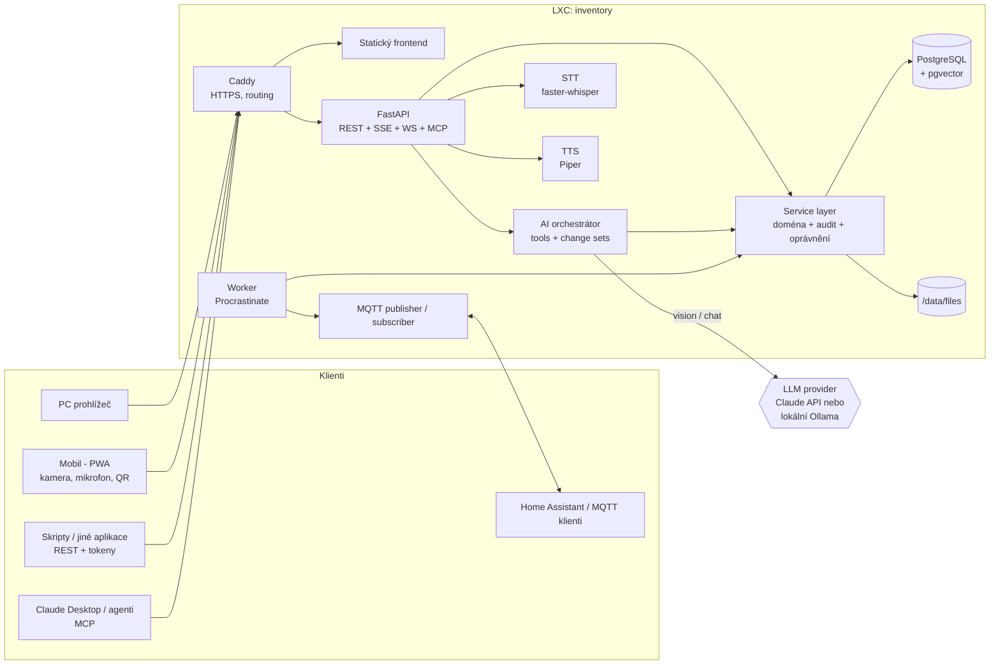

# Domácí inventář s AI asistentem – návrh řešení (v0.1)

> Pracovní název: **Domovník** (změň dle chuti). Self-hosted aplikace pro evidenci fyzických věcí v domě – *co to je, kde to leží, kolik toho je* – s grafickou správou, AI asistentem, fotkami, hlasem a integracemi.

## 1. Principy návrhu

1. **Jedna vrstva služeb (service layer) = jediná pravda.** UI, REST API, MQTT, hlas i AI asistent volají *stejné* funkce. Žádná logika neexistuje jen v jednom kanálu → vše je auditované, ověřené a testovatelné jednou.
2. **AI navrhuje, člověk schvaluje (do míry, kterou si nastavíš).** Každá změna z AI jde přes „balíček změn“ (change set) s náhledem a tlačítkem *Vrátit zpět*. Mazání AI nikdy neprovede bez potvrzení.
3. **Vše jde později upravit.** Přejmenování, přesun, změna stromu, sloučení kategorií, vlastní pole – nic není zadrátované. Historie + undo + koš.
4. **Fyzický svět je zdroj pravdy.** Bez štítků/QR kódů a inventury se databáze rozejde s realitou → QR štítky, režim inventury a rychlé „potvrď, že to tam je“ jsou součást jádra, ne bonus.
5. **Mobil je prvotřídní klient**, ne zmenšený desktop – věci se evidují stojíc před policí s telefonem v ruce.
6. **Soukromí napřed.** Fotky z interiéru domu jsou citlivé. Lokální AI je plnohodnotná varianta; cloudové AI je volitelné, s odstraněním GPS z EXIF a explicitním přepínačem.
7. **Všechno konfigurovatelné, ale s rozumnými výchozími hodnotami.** Nastavení se generuje z jednoho registru (kód = schéma + výchozí hodnota + popis + UI widget).

## 2. Doporučený technologický stack

| Vrstva | Volba | Proč | Alternativa |
|---|---|---|---|
| Databáze | **PostgreSQL 16** + `ltree`, `pg_trgm`, `unaccent`, `pgvector` | Strom umístění (ltree), fuzzy + fulltext + sémantické hledání v jedné DB, JSONB pro vlastní pole | SQLite + sqlite-vec (jednodušší provoz, slabší hledání a souběh) |
| Backend | **Python 3.12 + FastAPI**, SQLAlchemy 2, Alembic, Pydantic v2 | AI/STT/TTS ekosystém je v Pythonu, OpenAPI zdarma, async, SSE/WebSocket | Node/TypeScript (NestJS) – jeden jazyk s frontendem |
| Úlohy na pozadí | **Procrastinate** (fronta v Postgresu) | Žádný Redis navíc; thumbnails, analýza fotek, embeddings, MQTT outbox, zálohy | arq/Celery + Redis |
| Frontend | **React + TypeScript + Vite**, TanStack Table/Query, Tailwind + shadcn/ui, **PWA** | Jedna kódová báze pro PC i mobil, instalace na plochu, offline fronta | SvelteKit / Vue 3 |
| Auth | Session cookie (web) + Bearer API tokeny se scopes, argon2id; volitelně OIDC (Authelia/Authentik) | | |
| Soubory | Souborový systém `/data/files` (adresování podle sha256) + thumbnails WebP | Jednoduché na zálohu, bez S3 | MinIO/S3 |
| AI (LLM + vision) | **Abstrakce providerů**: Google Gemini (výchozí, free tier) · Anthropic Claude · OpenAI-kompatibilní (Ollama, vLLM, OpenRouter) | Výběr providera a záložní řetěz v nastavení, jiný model pro chat a pro fotky | LiteLLM jako brána |
| STT | **faster-whisper** (model `medium`/`large-v3-turbo`), VAD (silero) | Dobrá čeština, běží lokálně i na CPU pro krátké příkazy | Web Speech API (cloud, jen záloha), Wyoming protokol |
| TTS | **Piper** (hlas `cs_CZ-jirka`) | Rychlý, lokální, přijatelná čeština | Prohlížečový `speechSynthesis` (záloha), XTTS (náročnější) |
| Reverse proxy | **Caddy** (automatické HTTPS) | Mikrofon a kamera v prohlížeči fungují **jen přes HTTPS** | Traefik / nginx |
| MQTT | `aiomqtt` klient; používá existující broker (typicky Mosquitto v Home Assistantu) | | Vlastní Mosquitto v compose |
| Nasazení | **Docker Compose uvnitř LXC** na Proxmoxu | Reprodukovatelné, snadné aktualizace, Claude Code to umí vygenerovat | Čisté systemd služby bez Dockeru |

## 3. Architektura



**Důležité toky**
- *Zápis*: kanál → (oprávnění) → service layer → transakce {změna dat + `movements` + audit trigger + `event_outbox`} → worker publikuje do MQTT / webhooků / SSE (klienti v prohlížeči se aktualizují živě).
- *AI zápis*: asistent zavolá nástroj `propose_changes` → vznikne `ai_change_set` → podle úrovně důvěry se aplikuje hned, nebo čeká na potvrzení → aplikace používá stejné služby jako UI.
- *Fotka*: upload → uložení + thumbnaily (worker) → volitelně analýza (worker → VLM) → `photo_detections` → revizní obrazovka → change set.

## 4. Funkční moduly

### 4.1 Umístění (strom)
- Hierarchie libovolné hloubky: **Dům › Patro › Místnost › Zóna › Nábytek › Police/Zásuvka › Krabice**.
- Typy umístění (`kind`) mají vlastní ikonu/barvu, jsou editovatelné.
- **Pohyblivé kontejnery** (krabice, kufr, box na nářadí): přesun krabice = změna jejího rodiče, obsah jede s ní. Cesta všech věcí uvnitř se přepočítá automaticky (ltree).
- Každé umístění má štítek `label_code` (např. `L-GAR-A3`), fotku, poznámky, volitelnou kapacitu a vlastní atributy.
- Archivace místo mazání, sloučení a přesun podstromu.

### 4.2 Věci
- Pole: název, **aliasy** (synonyma), popis, **poznámky**, **kategorie**, **tagy**, **štítek `I-000123`**, stav (uloženo / používá se / půjčeno / v opravě / vyřazeno / prodáno / ztraceno), množství + jednotka, minimální zásoba, značka/model/sériové číslo/EAN, nákup (datum, cena, kde), záruka, expirace, odhad hodnoty, stav věci, vlastník, **domovské místo** (kam věc patří), fotky, dokumenty, vlastní pole podle kategorie.
- **Rozdělené množství**: 40 šroubů může být ve dvou krabicích (`item_placements`). Unikátní věc má jedno umístění s množstvím 1.
- **Nezařazeno (příjmový koš)**: věc bez umístění – ideální pro rychlé „nafocení hromady“ a zařazení později.
- Hromadné operace (přesun, změna kategorie, tagy, smazání), duplikace, sloučení duplicit, koš s obnovou.
- Vlastní pole definovaná na kategorii (např. kategorie *Baterie* → typ, kapacita, expirace), dědí se do podkategorií.

### 4.3 Grafická správa
- **Tabulka** (virtualizovaná, výběr sloupců, řazení, filtry, seskupení, inline editace, hromadné akce, uložené pohledy).
- **Galerie** (karty s fotkami), **Průzkumník umístění** (strom + obsah, drag & drop věcí mezi umístěními), později **plán domu** s piny.
- **Detail věci**: fotky, kde je (cesta + miniatura fotky police), historie pohybů, připomínky, zápůjčky, dokumenty.
- **Dashboard**: nezařazené, dochází zásoba, končí záruka/expirace, nedávné změny, zaplnění umístění, nepoužívané věci.

### 4.4 Kategorie a štítky
- Strom kategorií, barvy, ikony, vlastní pole; AI je umí navrhovat, slučovat a přesouvat (vždy přes change set s náhledem dopadu: „zasáhne 37 věcí“).

### 4.5 Fotografie
- Nahrávání z mobilu (kamera přímo v PWA, více snímků najednou) i z PC (drag & drop, HEIC → WebP/JPEG).
- Deduplikace přes SHA-256, EXIF orientace, odstranění GPS (nastavitelné), thumbnails 256/1024 px, blurhash placeholdery.
- Fotky věcí **i umístění** („takhle vypadá police B2“) – při hledání „kde je…“ se zobrazí fotka místa.
- Dokumenty (PDF návody, účtenky) s OCR textem pro fulltext.

### 4.6 Vyhledávání
- **Fulltext bez diakritiky** (`unaccent`) + **fuzzy** (`pg_trgm`, odolné vůči překlepům a skloňování) + **sémantické** (pgvector: „něco na utahování šroubů“ → šroubovák, nástrčné klíče).
- Hledání podle štítku, EAN, sériového čísla; filtr podle umístění včetně podstromu.

## 5. AI asistent

### 5.1 Co umí
| Schopnost | Příklad |
|---|---|
| Odpovídat na „kde je…“ | „Kde mám akušroubovák?“ → *Garáž › Regál A › Police 2 › Modrý kufr (1 ks)* + fotka |
| Obsah umístění | „Co je v krabici B3?“ |
| Evidovat přesuny | „Přesunul jsem kladivo do dílny.“ → návrh změny → potvrzení / auto-aplikace |
| Zakládat věci a umístění | „Přidej do krabice B3 12 baterií AA, expirace 2029.“ |
| Spravovat kategorie | „Vytvoř kategorii Zahradní nářadí a přesuň tam lopaty a hrábě.“ / „Navrhni lepší strukturu kategorií.“ |
| Hromadné úpravy | „Všem věcem v garáži bez kategorie navrhni kategorii.“ |
| Čtení fotek | viz 5.3 |
| Hlídat kvalitu dat | Duplicity, věci bez kategorie, nelogická umístění, zastaralé záznamy |
| Plánovat úklid | „Mám hromadu věcí po stěhování, jak to uložit?“ → Organizer mód (5.4) |

### 5.2 Jak funguje (bezpečně)
- **Function calling**: asistent má sadu nástrojů nad service layer.
  - *Čtecí* (bez omezení): `search_items`, `get_item`, `get_location_contents`, `list_locations`, `list_categories`, `find_duplicates`, `get_item_history`, `find_free_space`, `stats`.
  - *Zapisovací* (jen přes návrh): `propose_changes(ops[])` → vytvoří `ai_change_set` s operacemi (`create_item`, `move_item`, `merge_categories`, …).
- **Úrovně důvěry** (nastavení, i po typu operace):
  1. *Vždy se ptát* (výchozí) – karta s diffem „před → po“, tlačítka Potvrdit / Upravit / Zamítnout.
  2. *Drobné automaticky* – přesun jedné věci, přidání poznámky/tagu; hromadné (> N operací), kategorie a mazání se potvrzují.
  3. *Vše automaticky, s undo* – vždy zůstává tlačítko **Vrátit zpět** (inverzní operace uložena v `ai_change_ops.inverse`).
  - **Tvrdé pravidlo:** trvalé smazání AI nikdy neprovádí; měkké smazání (koš) vždy vyžaduje potvrzení.
- **Nejednoznačnost**: když najde víc kandidátů, zeptá se („Našel jsem 3 šroubováky – který myslíš?“). V hlasu čte max. 3 možnosti.
- **Kontext** v promptu je malý a stabilní (strom kategorií, horní úrovně umístění, aktuální umístění uživatele po naskenování QR, poslední pohyby) → **prompt caching**; zbytek si asistent dohledává nástroji, takže funguje i s 10 000 věcmi.
- **Vše je zaznamenáno**: konverzace, volání nástrojů, spotřeba tokenů/cena, změny v `audit_log` s odkazem na change set.
- **Rozpočet**: měsíční limit nákladů na cloudové AI v nastavení, přepnutí na lokální model po vyčerpání.

### 5.3 Čtení fotek (pipeline)
1. **Upload + kontext**: uživatel (ideálně po naskenování QR police) vyfotí hromadu/polici a případně napíše/nadiktuje: „věci po babičce, kuchyně“.
2. **Předzpracování**: otočení dle EXIF, zmenšení (~1568 px delší strana), u hustých polic i překrývající se dlaždice 2×2 + celek.
3. **VLM s vynuceným strukturovaným výstupem** (tool schema `report_detections`): pro každý předmět *label, popis, bbox, jistota, množství, značka/model, přečtený text (OCR štítku, EAN, sériové číslo), návrh kategorie z existujícího stromu (nebo nové), tagy*.
4. **Post-processing**: porovnání s existujícími věcmi (trigram + embeddings + EAN) → označení pravděpodobných **duplicit**; **návrh umístění** podle (a) kontextu fotky, (b) kde jsou uloženy podobné věci (kNN v embeddings), (c) volné kapacity, (d) domovského místa.
5. **Revizní obrazovka**: fotka s překryvem rámečků + karty k úpravě; *Přijmout / Upravit / Zamítnout / Sloučit s existující*, tlačítko „přijmout vše s jistotou > 80 %“.
6. **Potvrzení = change set** → věci vzniknou, fotka (a ořez podle bbox) se přiřadí ke každé věci, zaznamená se pohyb.
7. **Speciální typy**: účtenka (OCR → cena, datum, záruka), štítek/EAN (dohledání produktu), typový štítek (sériové číslo, model).

### 5.4 Organizer mód (postupy uložení)
Vstup: fotky nerozebrané hromady + dostupná umístění/krabice (a jejich zaplnění). Výstup: **plán krok za krokem** – „1. Založ krabici *Kabely* (štítek L-BOX-014). 2. Dej do ní tyto 14 věcí … 3. Ulož ji na Regál C / Police 1 (je tam místo)“. Každý krok je odškrtávací; odškrtnutí aplikuje příslušnou část change setu. Umí i **optimalizaci stávajícího stavu** („kam přesunout věci, ať se najdou rychleji“).

### 5.5 Poskytovatelé a konfigurace
- Samostatně nastavitelný model pro: *chat*, *vision*, *embeddings*, *klasifikaci kategorií*.
- **Podporovaní provideři (výběr v nastavení):** Google Gemini (**výchozí, free tier**), Anthropic Claude, OpenAI a libovolné OpenAI-kompatibilní API (Ollama, LM Studio, vLLM, OpenRouter). Každý provider = jeden adaptér se stejným rozhraním (chat + tool calling + obrázky + strukturovaný výstup + embeddings).
- **Řetěz záloh:** pořadí providerů per úloha (např. vision: Gemini → Claude). Při chybě 429/kvótě nebo výpadku se automaticky zkusí další.
- **Práce s free tierem:** analýza fotek běží ve frontě s omezením rychlosti (requests/min, denní limit zadaný v nastavení), počítadlo spotřeby kvóty, při vyčerpání se úloha odloží na další den nebo přepne na zálohu; hromadné nahrání 200 fotek se prostě zpracuje postupně. Konkrétní limity free tieru se mění – drží se v nastavení, ne v kódu.
- Doporučení: free Gemini pro start (vision i chat); placený klíč přidáš jen pokud kvalita/limity nestačí. Lokální Ollama je volitelná možnost, ne podmínka.
- Přepínače: „Povolit odesílání fotek do cloudu“, „Odstranit EXIF/GPS před odesláním“, „Automatická analýza po nahrání“, vlastní dodatek k system promptu, jazyk odpovědí, max. délka odpovědi, teplota, povolené nástroje.
- **Evaluační sada**: ~20 testovacích fotek s očekávaným výstupem, spouštěná při změně promptu/modelu (regresní test kvality).

## 6. Hlas (STT + TTS)

- **Mobil**: velké tlačítko mikrofonu – *podrž a mluv* nebo *klepni a mluv* (VAD ukončí nahrávání při pauze). Zvuk (WebM/Opus) → `POST /voice/stt` (nebo WebSocket s průběžným přepisem) → text jde stejným kanálem jako psaný dotaz.
- **STT**: faster-whisper běžící lokálně; pro lepší přesnost se do `initial_prompt` vkládá slovník domácnosti (názvy místností, krabic, kategorií a nejčastějších věcí). Nastavení: model, jazyk, VAD citlivost, slovník, záložní engine (Web Speech API).
- **TTS**: Piper, odpovědi se syntetizují po větách (stream), cache pro opakované věty. Nastavení: hlas, rychlost, hlasitost, *kdy mluvit* (vždy / jen po hlasovém dotazu / nikdy), stručný vs. podrobný režim, záložní `speechSynthesis`.
- **Hlasové odpovědi jsou jiné než textové**: krátké, bez tabulek a markdownu („Akušroubovák je v garáži, na druhé polici regálu A, v modrém kufru.“).
- **Fáze 2**: wake-word („Hej Domovníku“) pro nástěnný tablet/kiosk (openWakeWord), integrace Wyoming protokolu pro Home Assistant Assist.

## 7. Integrace

### 7.1 CSV export/import
- Export: volba sloupců, filtr (kategorie/umístění/stav), uložené šablony exportu, **české výchozí nastavení pro Excel** (oddělovač `;`, UTF-8 s BOM, desetinná čárka – přepínatelné), plná cesta umístění ve sloupci, jeden řádek na umístění věci nebo na věc.
- Další formáty: XLSX, JSON (plná záloha včetně vazeb).
- Import: nahrání → mapování sloupců → **dry-run s reportem chyb po řádcích** → potvrzení; párování existujících záznamů podle štítku/EAN/sériového čísla; automatické vytvoření chybějících kategorií/umístění (volitelné).

### 7.2 REST API
- `/api/v1/…` s OpenAPI/Swagger dokumentací: `items`, `locations`, `categories`, `tags`, `items/{id}/move`, `items/{id}/files`, `search`, `ai/chat` (SSE), `ai/photo-analysis`, `exports`, `imports`, `voice/stt`, `voice/tts`, `events` (SSE), `webhooks`, `settings`, `health`.
- API tokeny se **scopes** (`items:read`, `items:write`, `ai:chat`, `admin`), expirací, jednorázovým zobrazením, rate-limitem.
- **Optimistické zamykání** (`version` + `If-Match`), `Idempotency-Key` pro bezpečné opakování, kurzorová stránkovace.
- **Webhooky** (podepsané HMAC) pro události.
- **MCP server** (`/mcp`) – stejné nástroje jako AI asistent, takže se dá domácí inventář ptát i z Claude Desktop nebo jiných agentů (téměř zadarmo, protože nástroje už existují).

### 7.3 MQTT
Dvousměrně, vše konfigurovatelné (broker, TLS, uživatel/heslo, prefix, QoS, retain, které události, šablony payloadu):

| Topic (prefix `domovnik`) | Směr | Obsah |
|---|---|---|
| `domovnik/status` | ven, retained, LWT | `online` / `offline` |
| `domovnik/event/item/{created,updated,moved,deleted}` | ven | JSON události (věc, odkud, kam, kdo, kanál) |
| `domovnik/item/<I-000123>/state` | ven, retained | název, umístění, množství, stav |
| `domovnik/location/<L-GAR-A3>/state` | ven, retained | počet věcí, zaplnění |
| `domovnik/stats` | ven, retained | celkem věcí, nezařazeno, dochází zásoba |
| `domovnik/cmd/item/move` | dovnitř | `{"item":"I-000123","to":"L-GAR-A3","qty":1}` |
| `domovnik/cmd/item/create` | dovnitř | JSON nové věci |
| `domovnik/cmd/ai/ask` | dovnitř | `{"text":"kde mám lepicí pásku?","corr":"abc"}` → odpověď na `domovnik/cmd/response/abc` |

- **Home Assistant MQTT Discovery**: zařízení „Domovník“ se senzory (počet věcí, nezařazeno, dochází zásoba) a volitelně binary_sensor „dochází“ pro vybrané věci.
- Příkazy z MQTT běží pod servisním uživatelem s omezenými právy a procházejí stejnou service vrstvou (audit, validace). Publikace jde přes `event_outbox` (nic se neztratí při výpadku brokeru).

### 7.4 Home Assistant a AI na reproduktoru
Reproduktor obsluhuje **Home Assistant Assist** (jeho STT/TTS, wake-word, satelity). Aplikace do něj dodává „mozek“; hlas se tedy nemusí řešit dvakrát. Tři cesty, od nejelegantnější:

1. **MCP (doporučeno):** Home Assistant má integraci *Model Context Protocol* (klient). Přidáš MCP server Domovníku (`/mcp`) a LLM konverzační agent v HA (Gemini/Claude/…) dostane nástroje `search_items`, `get_location_contents`, `propose_changes` atd. Řekneš „Hey, kde mám lepicí pásku?“ a HA odpoví hlasem. Zápisy z reproduktoru jdou jako change set s potvrzením („Přesunout kladivo do dílny, potvrdit?“ – ano/ne).
2. **REST:** endpoint `POST /api/v1/ai/ask` (`{"text": "...", "style": "voice", "session": "kuchyne"}`) vrací krátkou odpověď bez markdownu; v HA ho zavoláš přes `rest_command` + vlastní věty (custom sentences, např. „kde mám {vec}“) a odpověď přečte TTS na zvoleném reproduktoru.
3. **MQTT:** `domovnik/cmd/ai/ask` → odpověď na `domovnik/cmd/response/<corr>`; hodí se pro automatizace bez HA integrace.

Pravidla: reproduktor má vlastní servisní účet/token s omezenými scopes (`items:read`, `ai:chat`; zápisy jen se slovním potvrzením), odpovědi jsou stručné (max. 3 možnosti), identifikace místnosti z HA satelitu se předává jako kontext („jsem v kuchyni“).

## 8. Katalog nastavení (všechny funkce konfigurovatelné)

| Skupina | Příklady položek |
|---|---|
| Obecné | název domácnosti, jazyk, časová zóna, měna, formát data/čísel, motiv, hustota UI |
| Uživatelé & role | admin / člen / čtenář / host, hesla, 2FA, délka session, OIDC |
| Umístění | typy umístění + ikony, formát štítků, povinná pole, chování při přesunu podstromu |
| Věci | povinná pole, formát `label_code`, politika duplicit, retence koše, výchozí jednotky, výchozí sloupce |
| Kategorie & pole | správa vlastních polí, dědičnost, šablony kategorií |
| Fotky | max. rozměr, kvalita, thumbnails, HEIC, odstranění GPS, úložiště, retence originálů |
| AI | provider + model per úloha, API klíče (šifrovaně), úroveň důvěry per operace, systémový prompt, povolené nástroje, rozpočet, cloud ano/ne, auto-analýza fotek |
| Hlas | STT/TTS engine, model, hlas, rychlost, VAD, slovník, kdy mluvit, wake-word |
| Hledání | práh fuzzy, sémantické hledání on/off, synonyma, váhy polí |
| Štítky & tisk | šablony, rozměry, QR vs. čárový kód, tiskárna (CUPS/IPP/Brother QL) |
| Upozornění | e-mail (SMTP), push (ntfy / Web Push), kdy upozorňovat (záruka X dní předem, expirace, nízká zásoba) |
| Import/Export | oddělovač, kódování, desetinný znak, výchozí šablony |
| MQTT | broker, TLS, prefix, QoS, retain, události, HA discovery, příkazy zapnout/vypnout |
| API | tokeny, scopes, CORS, rate-limit, webhooky, MCP zapnout/vypnout |
| Zálohy | plán, cíl, retence, šifrování, test obnovy |
| Bezpečnost | politika hesel, IP allowlist, audit retence |
| Pokročilé | úroveň logů, feature flags, údržba (reindex, přegenerování embeddings, thumbnails) |

Každá položka má: klíč, typ, výchozí hodnotu, popis, validaci, „vyžaduje restart?“ a oprávnění. Uživatelské nastavení (jazyk, motiv, hlas) přepisuje globální.

## 9. UI – hrubý návrh

**PC** – tři sloupce: vlevo **strom umístění** (filtr jedním klikem), uprostřed **tabulka/galerie**, vpravo **detail** (drawer). Dokovatelný panel **Asistent** (chat + karty změn) dole/vpravo, vyhledávání `Ctrl+K`. Klávesové zkratky pro rychlé zadávání.

**Mobil** – spodní navigace: **Hledat · Skenovat · ➕ Přidat · Asistent (🎤) · Více**.
- *Skenovat*: kamera přečte QR umístění/věci → „Jsem tady“ režim (kontext pro přidání: „přidej sem baterie AA 12 ks“).
- *Přidat*: fotka → AI rozpozná → potvrď kartu → hotovo (3 klepnutí).
- *Offline*: fronta změn v IndexedDB (sklep/garáž bez Wi-Fi), synchronizace při připojení; id (UUID) generuje klient.

## 10. Nasazení na Proxmoxu (LXC)

### 10.1 Doporučená topologie
```
Proxmox host
├─ LXC 200 "domovnik" (Debian 12, unprivileged, nesting=1, keyctl=1)   ← celá aplikace
│    Docker Compose: caddy · api · worker · postgres(pgvector) · stt · tts [· mosquitto]
│    /data (bind mount z ZFS datasetu / disku) → files/, pgdata/, backups/
└─ (volitelně) LXC/VM "ai-gpu" s GPU passthroughem → Ollama / vLLM / větší Whisper
```
Aplikace volá AI přes URL, takže GPU stroj je volitelný a vyměnitelný (nebo se použije jen cloud).

### 10.2 Dimenzování
| Scénář | vCPU | RAM | Disk |
|---|---|---|---|
| Základ (bez lokálního STT/TTS) | 2 | 3 GB | 16 GB root + `/data` dle fotek |
| Doporučený (+ Whisper `small/medium` CPU, Piper) | 4 | 8 GB | 32 GB root + `/data` 100+ GB |
| Lokální LLM/VLM | samostatný stroj/LXC s GPU (min. 12–16 GB VRAM pro 7B VLM) | | |

### 10.3 Vytvoření kontejneru (ukázka)
```bash
pct create 200 local:vztmpl/debian-12-standard_12.7-1_amd64.tar.zst \
  --hostname domovnik --unprivileged 1 --features nesting=1,keyctl=1 \
  --cores 4 --memory 8192 --swap 1024 \
  --rootfs ssdpool:32 --mp0 ssdpool:100,mp=/data,backup=1 \
  --net0 name=eth0,bridge=vmbr0,ip=dhcp,firewall=1 --onboot 1
```
Poznámky:
- Úložiště odpovídá tvému Proxmoxu: kontejner i `/data` leží na **LVM-thin `ssdpool`** (ext4 uvnitř), šablony na `local`, zálohy na **PBS `PBSprodesk`**. `backup=1` zařadí `/data` (fotky, DB) do `vzdump` snapshotu → PBS ukládá inkrementálně a deduplikovaně.
- **Docker v LXC** funguje s `nesting=1,keyctl=1`; na LVM-thin (ext4) běží overlay2 bez problémů (obava s ZFS se tě netýká). Název šablony (`debian-12-standard_…`) uprav podle toho, co máš ve `local` (`pveam list local`).
- Provisioning skript (`deploy/proxmox/create-lxc.sh`) a cloud-init-like bootstrap (`deploy/bootstrap.sh`: Docker, uživatel, UFW, compose) vygeneruje Claude Code ve fázi 10.
- **HTTPS je nutné** (kamera/mikrofon/PWA). Rozhodnuto: **dnes** Caddy `tls internal` + kořenový certifikát nainstalovaný do obou Android telefonů; **později** existující **Nginx Proxy Manager** s Let's Encrypt (doména). Caddy je proto v `compose.prod.yml` jen volitelný profil (`--profile caddy`); aplikace sama poslouchá na HTTP na interním portu a respektuje `X-Forwarded-*`. Vzdálený přístup přes VPN – **ne** přímé vystavení portů.
- Při provozu za NPM: zapnout WebSockets, vypnout `proxy_buffering` pro SSE, `client_max_body_size` ≥ 50 MB (fotky), dlouhý `proxy_read_timeout` (streamované odpovědi AI).

### 10.4 Zálohy a aktualizace
- Úroveň 1: **vzdump snapshot LXC** do Proxmox Backup Serveru (`PBSprodesk`, denně). Pozor na konzistenci databáze: před snapshotem hook v `vzdump` (nebo `fsfreeze` + `CHECKPOINT`), případně spoléhat na úroveň 2 (`pg_dump`).
- Úroveň 2: aplikační – `pg_dump` (denně) + `restic` na `/data/files` na externí cíl (offsite, šifrovaně). Plán a retence v nastavení aplikace.
- **Pravidelný test obnovy** (skript + připomínka) – záloha, kterou jsi nezkusil obnovit, není záloha.
- Aktualizace: `docker compose pull && up -d`; Alembic migrace běží při startu po automatickém snapshotu DB; verze v `/health`.

## 11. Bezpečnost
HTTPS všude, argon2id, session cookies `HttpOnly`+`SameSite`, CSRF ochrana, rate-limit loginu, API tokeny hashované, scopes, tajemství (API klíče, MQTT heslo) šifrovaná v DB masterklíčem mimo DB, validace nahraných souborů (typ, velikost, re-enkódování obrázků), ochrana proti SSRF u webhooků, **ochrana proti prompt injection** (text přečtený z fotek/dokumentů je *data*, nikdy instrukce; asistent nemá nástroje pro mazání ani exfiltraci; zapisovací nástroje jen přes change set).

## 12. Nedostatky v zadání a jak je řeším

| # | Mezera | Řešení v návrhu |
|---|---|---|
| 1 | Neřeší se **fyzické značení** – bez štítků se databáze rozejde s realitou | QR/čárové štítky pro věci i umístění, skenování v mobilu, tisk (PDF/tiskárna), režim inventury |
| 2 | **Uživatelé a oprávnění** (rodina, host, dítě) | Role, API tokeny se scopes, audit „kdo co změnil“ |
| 3 | **HTTPS** – mikrofon/kamera nejdou bez něj | Caddy + interní CA nebo DNS-01 certifikát |
| 4 | **Důvěra v AI** (halucinace, hromadné chybné změny) | Change sets, náhled dopadu, undo, tvrdé zákazy, audit |
| 5 | **Soukromí fotek** a **náklady** AI | Lokální provider, přepínač cloudu, odstranění GPS, měsíční rozpočet, sledování tokenů |
| 6 | **Offline** v garáži/sklepě | PWA fronta změn, UUID generované klientem |
| 7 | **Souběžné úpravy** | `version` + optimistické zamykání, živé aktualizace přes SSE |
| 8 | **Množství vs. unikátní kusy**, spotřební materiál | `item_placements` s množstvím, min. zásoba, jednotky |
| 9 | **Duplicity** | SHA-256 souborů, EAN, trigram+embeddings, „sloučit“ |
| 10 | **Čeština ve vyhledávání** (skloňování, bez diakritiky) | unaccent + trigram + aliasy + sémantické hledání |
| 11 | **Čeština v STT** | Whisper medium+, slovník domácnosti, záložní engine |
| 12 | **Zálohy a obnova** (fotky = největší data) | Dvouúrovňové zálohy, test obnovy |
| 13 | **Migrace stávajících dat** | CSV/XLSX import s dry-runem a mapováním |
| 14 | **Evoluce schématu** | Alembic, verze API, exporty ve verzovaném JSON |
| 15 | **Monitoring** | `/health`, metriky, logy, upozornění při selhání záloh |
| 16 | **Zdroj pravdy u MQTT** (smyčky, ztráty) | Outbox, korelační ID, servisní uživatel, QoS dle nastavení |
| 17 | **Vícejazyčnost** | i18n od začátku (cs výchozí, en připraveno) |
| 18 | **Kdo to celé naplní?** (největší riziko adopce) | Foto → AI → 3 klepnutí; import; Organizer mód; režim „nezařazeno“ |

## 13. Další navrhované funkce

**Must / brzy**
- QR štítky + tisk (Brother QL / Niimbot / PDF A4 na etikety), skenování kamerou.
- Režim **inventury** (projdi polici, odškrtni, co chybí/přebývá).
- **Zápůjčky** (komu, kdy, do kdy, připomínka).
- **Připomínky**: záruka, expirace, nízká zásoba, periodická údržba (revize kotle, výměna filtrů).
- **Koš a historie** s obnovou.

**Should**
- **Nákupní seznam** z nízké zásoby (sdílený, export).
- **Sady / balicí seznamy** (dovolená, lyžování, kempování – „vezmi tyto věci“, kontrola po návratu).
- **Doklady a návody** (PDF u věci, OCR účtenek → záruka automaticky).
- **Pojistný report**: soupis majetku s hodnotou a fotkami (PDF/CSV) pro pojišťovnu.
- **Skenování EAN** + dohledání produktu (Open Food Facts / UPCitemdb) pro předvyplnění.
- **Hodnota a odpisy**, souhrn podle místnosti/kategorie.
- **Detekce nepoužívaných věcí** („nepoužito 2 roky – prodat/darovat?“), funkce *Úklid & vyřazení* (prodáno/darováno/recyklace).
- **Hlas v terénu**: hands-free dávkové zadávání („další … další … hotovo“).

**Could / později**
- **Plán domu** (půdorys s piny, nahrání obrázku, klik na místnost).
- **NFC tagy** na krabice.
- **Home Assistant**: karta v dashboardu, automatizace („dochází papírové utěrky → přidej do nákupního seznamu“).
- **Telegram/Signal bot** nebo e-mail-in („přepošli účtenku“).
- **Kalendář** (revize, sezónní věci: „v říjnu vytáhni zimní pneumatiky“).
- **Sezónní umístění** (letní/zimní věci se přesouvají cyklicky).
- **Vícedomácnostní provoz** (chata, garáž u rodičů) – oddělené inventáře, sdílené kategorie.
- **Mobilní widget / Siri/Google Assistant zkratka** („kde mám…“ → API).

## 14. Roadmapa (shrnutí; detail v `04-postup-claude-code.md`)

Pořadí je upraveno podle rozhodnutí: **AI čtení fotek je primární cesta k naplnění databáze**, proto přichází hned po základní správě a mobilním vstupu.

| Pořadí | Fáze | Obsah | Výsledek |
|---|---|---|---|
| 1 | F0 | Kostra repa, dev prostředí, CI | běží prázdná appka + DB |
| 2 | F1 | DB, doména, auth, nastavení | funkční jádro s testy |
| 3 | F2 | REST API + hledání + audit | použitelné API |
| 4 | F3 | Webové UI (PC) | správa tabulkou |
| 5 | F4 | Fotky | upload, galerie, thumbnails |
| 6 | F5a | PWA, mobilní layout, kamera, HTTPS | **mobil v ruce u police** |
| 7 | F6 | AI core: providery (Gemini…), chat, change sets, undo | „kde je…“, přesuny, kategorie |
| 8 | F7 | AI čtení fotek + Organizer | **rychlé naplnění databáze (první opravdu použitelná verze)** |
| 9 | F5b | QR štítky (PDF), offline fronta, inventura | volitelné značení, spolehlivost |
| 10 | F9 | MQTT, HA integrace (MCP/REST), CSV/XLSX, tokeny, webhooky | integrace |
| 11 | F8 | Hlas v aplikaci (STT/TTS) | ovládání hlasem z mobilu |
| 12 | F10 | Produkční nasazení, zálohy, hardening | provoz na LXC |

Poznámka: produkční nasazení (F10 – LXC, HTTPS, zálohy) doporučuji **udělat zkráceně už po F5a**, aby mobil mohl od začátku běžet přes HTTPS a aby se reálná data plnila do skutečné instance, ne do vývojové.
