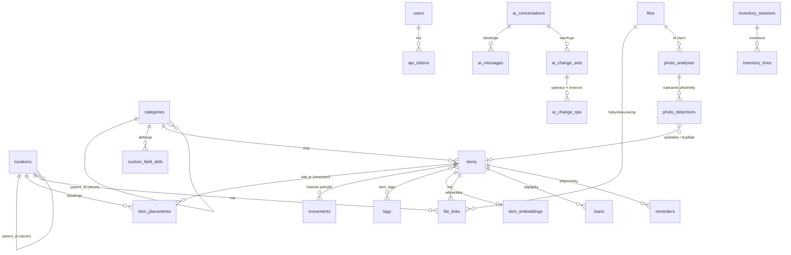

# Návrh databáze

Referenční implementace: [`../db/schema.sql`](../db/schema.sql) – PostgreSQL 16 + pgvector. Schéma bylo načteno na čisté instanci (`pgvector/pgvector:pg16`) a otestováno smoke testem: strom umístění (přesun krabice přepočítá cesty), fulltext bez diakritiky, vyhledání podle tagu, audit trigger, odmítnutí cyklu ve stromu.

## 1. Proč PostgreSQL

| Potřeba | Řešení v PG |
|---|---|
| Strom umístění s přesunem podstromů | `ltree` + GiST index, dotaz „vše uvnitř police“ = `path <@ ...` |
| Hledání bez diakritiky, překlepy, skloňování | `unaccent` + `pg_trgm` + aliasy |
| Sémantické hledání („něco na šrouby“) | `pgvector` (HNSW) |
| Vlastní pole podle kategorie | `JSONB` + GIN, definice v `custom_field_defs` |
| Offline klient generuje ID | UUID primární klíče (`gen_random_uuid()`) |
| Spolehlivé události pro MQTT/webhooky | transakční outbox (`event_outbox`) |
| Audit bez ohledu na kanál | generický trigger `audit_row()` |

*Lehčí varianta:* SQLite + `sqlite-vec`. Zvaž ji jen když chceš minimální provoz a nevadí ti slabší fulltext a absence ltree (strom by se řešil rekurzivními CTE). Rozhodnutí je v otázkách (03).

## 2. Konceptuální model

## 3. Klíčová rozhodnutí

1. **Umístění je strom, krabice je umístění.** Mobilní kontejner (`is_movable`) je běžný uzel stromu; přesun = změna `parent_id`, trigger přepočítá `path`/`depth` celého podstromu a brání cyklům. Alternativa „krabice je věc“ komplikuje dotazy – kdo chce krabici i evidovat jako majetek, může ji mít jako položku s atributem odkazujícím na umístění (rozšíření později).
2. **Věc ≠ umístění věci.** `items` je „co to je“, `item_placements` je „kde a kolik“. Důvod: spotřební materiál bývá na více místech; unikátní kus má prostě jeden řádek s množstvím 1. Věc bez řádku = *nezařazeno*. `home_location_id` říká, kam věc *patří* (pro „vrať na místo“ a detekci bordelu).
3. **Štítek (`label_code`) je stabilní lidský identifikátor** (`I-000123`, `L-GAR-A3`), který se tiskne a kóduje do QR. Nikdy se nemění, i když se věc přejmenuje nebo přesune.
4. **Kategorie jsou strom + vlastní pole.** Hodnoty v `items.attributes` (JSONB), definice v `custom_field_defs` (dědí se do podkategorií). Změna kategorie nemaže data – nepoužitá pole zůstanou v JSONB a lze je smazat nástrojem údržby.
5. **Tagy** jsou ploché, doplňují kategorie (průřezové vlastnosti: „zimní“, „křehké“, „půjčit nelze“).
6. **Verzování řádků (`version`)** pro optimistické zamykání: klient posílá `If-Match: <version>`, souběžná úprava vrátí 409 místo tichého přepsání.
7. **Soft delete** (`deleted_at`) u věcí, archivace (`archived_at`) u umístění. Smazání kategorie/umístění, které něco obsahuje, je zakázáno (`ON DELETE RESTRICT`) – nejdřív se obsah přesune/sloučí.
8. **Dvě vrstvy historie, každá s jiným účelem:**
   - `movements` – *byznysová* historie („kladivo: Garáž → Dílna, 3. 11., hlasem“), rychlý dotaz „kde to bylo předtím“.
   - `audit_log` – *technická* historie každé změny řádku (před/po JSONB) s kanálem a odkazem na change set; základ pro obnovu a forenzní dohledání. Plní ji trigger, takže pokryje i import, MQTT a ruční zásah.
9. **AI change sets** (`ai_change_sets` + `ai_change_ops`): operace mají `payload` a po aplikaci `inverse` → **undo** je mechanické. Stav `proposed` čeká na potvrzení.
10. **Outbox** (`event_outbox`): zápis události ve stejné transakci jako změna; worker publikuje do MQTT/webhooků/SSE a označí `published_at`. Při výpadku brokeru se nic neztratí.
11. **Soubory** jsou adresované hashem (`sha256` unikátní) → stejná fotka se neukládá dvakrát. `file_links` je M:N vazba s rolí (primární fotka, návod, účtenka…).
12. **Embeddings** v samostatné tabulce s `content_hash` – přegeneruje se jen při změně textu. Dimenze vektoru (1024) je pevná per tabulka; změna modelu s jinou dimenzí = migrace + reindex.

## 4. Nastavení v databázi

`settings` drží jen *hodnoty* (`scope` = global/user, `key`, `value` JSONB, `is_secret`). **Schéma nastavení (typ, výchozí hodnota, popis, validace, UI widget) žije v kódu** jako registr – díky tomu: nová funkce = nový záznam v registru, žádná migrace; UI nastavení se generuje samo; tajné hodnoty se šifrují aplikačním klíčem (nikdy v DB v plain textu).

## 5. Výkon a údržba

- Očekávaný rozsah: 1 000 – 50 000 věcí → vše v rámci jedné instance PG bez ladění. Kritické indexy jsou součástí schématu (GIN na `search_tsv`, trigram, GiST na `path`, HNSW).
- `audit_log` a `movements` rostou nejrychleji → retence v nastavení a případné měsíční partitioning (zatím netřeba).
- Údržbové úlohy ve workeru: přegenerování embeddings, `REINDEX`, úklid osiřelých souborů, kontrola konzistence (`item_placements` na archivovaná umístění, věci bez kategorie).

## 6. Migrace a verzování

- Alembic; první migrace = `schema.sql` rozdělené do revizí (rozšíření → základ → AI → integrace).
- Před každou migrací při startu v produkci automatický `pg_dump`.
- Triggery a funkce jsou součástí migrací (testují se v CI proti skutečnému Postgresu přes testcontainers, ne proti SQLite).

## 7. Známá omezení v0.1 (vědomě odloženo)

- Jedna domácnost = jedna databáze (vícedomácnostní provoz by přidal `household_id` do všech tabulek – rozhodni se předem, viz otázky).
- Práva jsou na úrovni rolí, ne po umístěních (např. „dítě vidí jen svůj pokoj“ – lze přidat `location_acl`).
- Embedding dimenze 1024 (bge-m3 / multilingual-e5-large); lokální model s jinou dimenzí vyžaduje úpravu.
- Search konfigurace `simple` – žádná česká lemmatizace; skloňování pokrývají trigramy + aliasy + embeddings.
